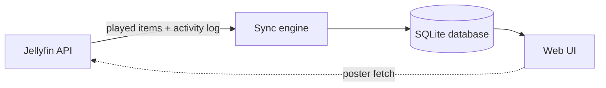

<p align="center">
  
</p>

# Tana 🎬

**Tana (棚, たな, “shelf” in Japanese) is a privacy-friendly, self-hosted watch-history tracker for Jellyfin.** It reconstructs your watch history directly from the Jellyfin API (no webhook plugin needed), tracks in-progress movie starts, lets you favorite items and manually mark a started movie as watched, stores everything in a local SQLite database, and serves a small web UI with statistics, filters, and poster images. All data stays on your own host; the only outbound traffic is to your Jellyfin server.

AI tools were used during development.

## 🙋 Why Tana?

There are other great self-hosted tracking projects, such as [Yamtrack](https://github.com/FuzzyGrim/Yamtrack). I created Tana for two reasons: first, I wanted a simpler way to track my watch history; second, I wanted to see how far I could get with agentic coding, as I’m open to new technologies and approaches to software development.

## 🧭 How it works



A scheduled sync reads the configured user's Movies/Episodes and, when the API key has dashboard access, Jellyfin's activity log (a 30-day session window by default). Jellyfin's per-item `Played` flag (and `PlayedPercentage`) is the only completion fact — its `PlayCount` counts playback *starts*, so Tana never treats it as a completion count. Every recent playback session is paired with its start and measured against the item's runtime, so sessions that plausibly finished get an exact date while brief re-opens are excluded; older or unverifiable plays are kept as an estimate bounded by `PlayCount` minus the clearly-partial sessions observed in the window. In-progress movies get a separate *started* state, local favorites and manual-watched actions are first-class flags, and the Zola-built UI renders stats, a started/watched list, and media.

## 🚀 Quick start

1. Copy `example.env` to `.env` and set `JELLYFIN_API_KEY` (create one in Jellyfin under **Dashboard → API Keys**) and `JELLYFIN_USER_ID`. `JELLYFIN_URL` defaults to `http://jellyfin:8096` in Compose; adjust it to an address reachable from the Tana container. Non-secret settings live in the `environment:` block of `docker-compose.yaml`; only the API key is required in `.env`.
2. Create the host data directory. Compose runs the container as non-root UID/GID `10001:10001`, and the mounted `/data` directory must be writable by it:

   ```sh
   mkdir -p ./tana-data
   sudo chown -R 10001:10001 ./tana-data
   ```

3. Start and follow the logs:

   ```sh
   docker compose pull
   docker compose up -d
   docker compose logs -f tana
   ```

Exact per-session dates (within Jellyfin's activity-log window) come from the admin activity log, so give the API key **dashboard access** when you create it; without it Tana falls back to the per-item estimate alone. The example Compose file pulls the published `ghcr.io/divin/tana` image; no local Docker build is needed. It maps host port `8000` to container port `8000` on all host interfaces. Tana has no login, so only expose it to a trusted LAN or place it behind an authenticated reverse proxy. Containers are published only on plain version tags; `:latest` always points at the newest tagged release, so `docker compose pull` after a release updates the running image.

## 🎬 Watch tracking

Tana records a movie or episode as watched only when Jellyfin's state proves a completion: the item's `Played` flag is set, or its `PlayedPercentage` reaches `PLAYBACK_COMPLETION_THRESHOLD` (default `1.0`; valid `0.5`–`1.0`). `PlayCount` is deliberately not used as a completion counter — Jellyfin increases it every time playback *starts*, so a movie opened briefly on four devices would otherwise look like four watches.

For a completed item, Tana estimates the watch count as `max(1, PlayCount − clearly-partial sessions in the activity-log window)`. A session whose merged start-to-stop span reaches the threshold of the item's runtime is stored with its exact completion date; a session clearly shorter than the runtime (a re-open, an abandoned start) never counts as a watch and never appears as a date. Unverifiable older plays are approximated at the item's `LastPlayedDate`. Marking an item **unplayed in Jellyfin** removes it from Tana on the next sync; items you have never completed never appear, no matter how often you started them.

A movie currently in progress gets a separate *started* state that never counts as a play until completion: the UI shows `Started` with the started date, and prior verified plays as `Previously watched …` without implying the current start is complete. A flag button on every movie card shows whether it is watched (filled) or not (empty) and toggles the local manual correction on a started movie; manual marks never fabricate a playback event and do not increment play counts or add to the activity heatmap. Favorites and manual corrections are local; the first completion is one play and later completions count as rewatches.

## ⚠️ Known limitations and how counts are estimated

Jellyfin's API was not designed to expose watch history, so Tana has to reconstruct it and the numbers are estimates, not guarantees:

- **`PlayCount` is a start counter, not a finish counter.** Jellyfin increments it whenever playback starts (`SessionManager.OnPlaybackStart`), so Tana never trusts it directly as “times watched”. It is only a bound.
- **No per-session completion data exists.** The activity log records session start/stop times but not playback position, so Tana infers whether a session finished by comparing its wall-clock span to the item's runtime. This is reliable for short re-opens (a 20-second start is clearly not a watch), but a session that is paused for a long time or finished across multiple sessions can be misjudged.
- **Exact sessions only reach back ~30 days** (server setting `ActivityLogRetentionDays`). Older plays cannot be dated precisely; they appear at the item's `LastPlayedDate`.
- **`Played=true` may also come from marking an item played manually inside Jellyfin**; the API cannot distinguish that from a real completion.
- **Dashboard access is required for the session window.** A restricted API key silently falls back to the per-item estimate (less accurate dates).
- **The count for a completed item is capped at `max(1, PlayCount − clearly-partial recent sessions)`.** Brief re-opens no longer inflate it, but partial starts from before the session window, and multi-session finishes, can still tip the estimate.

In short: “watched” means Jellyfin attests a completion; “N times” is Tana's best-effort figure.

## 📊 Web UI

Tana's index page shows total plays and activity over time, media with posters, rewatch/started/manual labels, IMDb links for movies, kind/status/date filters and a favorites toggle, local favorite hearts and a watched-state flag, and 7/30-day statistics including started movies. Timeline data respects the configured `TZ`. The theme choice is stored locally in the browser. The app has no login; anyone who can reach it can also change favorites and manual state, so keep it on a trusted LAN or behind an authenticated reverse proxy.

## 💾 Data and privacy

The SQLite database and resized poster files live together under the mapped host directory, so back them up together (for example stop the container and `tar -czf` the directory; Tana recreates posters on demand if the `posters/` folder is removed). Item IDs, API keys, and secrets are never logged. Tana only talks to its configured Jellyfin server; it reports nowhere else.

## ⬆️ Upgrading

Version 3.0.0 is a complete backend rewrite that uses SQLite schema version 5 and no longer receives Jellyfin webhooks. On startup, any database whose schema version is not 5 (including older Tana 1.x/2.x data) is deleted and recreated fresh — the watch history is then rebuilt automatically from the Jellyfin API on the first sync. Favorites and manual corrections are local preferences; they only survive an upgrade when the history they refer to is rebuilt. Back up the data directory before upgrading and review the [3.0.0 roadmap](spec/version-3.md) for the full behavior contract.

## 🧪 Development

Use Python 3.12, [`uv`](https://docs.astral.sh/uv/), Zola 0.23.6, Node.js 22, and [`just`](https://just.systems/). Copy `example.env` to `.env` (gitignored) for local runs, then from the repository root:

```sh
just sync  # Install the locked backend environment
just       # Run all checks and tests
just run   # Build the site and start a LAN-accessible server on port 8000
```

`just run` stores its database and posters in the ignored `.local-data/` directory and leaves the production `/data` path untouched. Remove `.local-data/` to discard the test copy.
